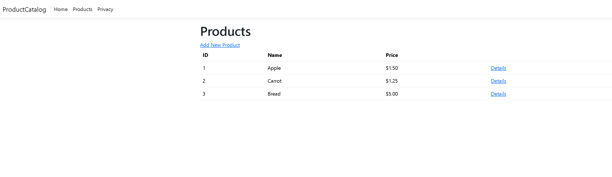
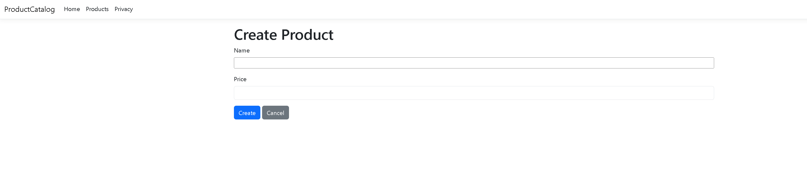
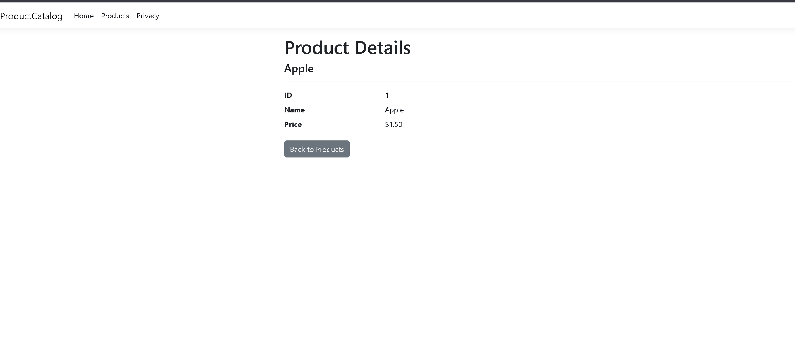

# Product Catalog
## Description
An ASP.NET Core MVC application that allows users to create, view, and list products.

The application uses a Product model with validation for required names and prices between $0.01 and $1,000.00.
Products are stored in data/products.json so they persist between application runs.

The application includes three main pages:
- **Index:** Displays all products with their IDs, names, and prices.
- **Create:** Allows users to add products with input validation.
- **Details:** Displays information about an individual product.

## Screenshots

### Products Index Page

### Create Product Page

### Sample Details Page

